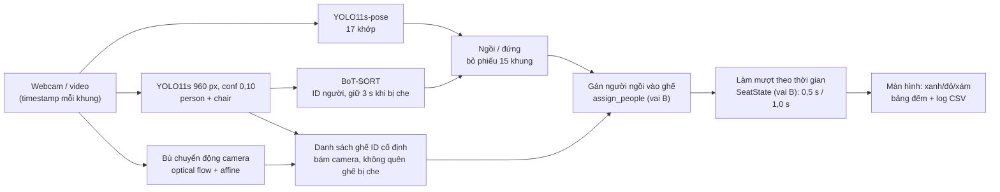

# Báo cáo Capstone Track 4: LibSeat, đếm chỗ trống thư viện VinUni bằng camera

**Team Triangle** · Vin Perception Hackathon · Track 4 (Computer Vision & Robotics)
Đơn vị Vin: **VinUni** (thư viện, phòng tự học) · Repo: <https://github.com/naoh-pt/K4-Track4-Capstone-TeamTriangle>

**Video đã xử lý (có output của mô hình):** [Google Drive](https://drive.google.com/drive/folders/1d__Y2MqwEUp6zbe5VIRAbpQYwnfEw9Wo). Video không đưa lên GitHub, `.gitignore` chặn `*.mp4`, `video_test/` và `kaggle/output/`.

---

## 0. Thành viên và vai trò

| Họ tên | MSSV | Vai trò | Phụ trách | File chính |
|---|---|---|---|---|
| Lê Châu Trần Phát | 2A202602545 | **A**: Pipeline và model | Webcam/video, YOLO + ByteTrack, giao diện OpenCV, log FPS | `src/app.py`, `src/detect.py`, `RUN_GUIDE.md` |
| Phan Trọng Hoàn | 2A202602954 | **B**: Hình học và bất định | Homography ảnh → sàn, gán người vào ghế, làm mượt theo thời gian, unit test | `src/geometry.py`, `src/smoothing.py`, `src/occupancy.py`, `src/calibrate.py`, `tests/`, `docs/` |
| Nguyễn Đăng Thực | 2A202603014 | **C**: Dữ liệu, đo, trình bày | Dataset, đánh giá CALIB/TEST, ca lỗi, chạy GPU Kaggle, video test, video demo | `libseat/`, `kaggle/` |

---

## 1. Bài toán và người dùng

**Nỗi đau.** Mùa thi, sinh viên VinUni đi vòng các tầng thư viện để tìm một ghế trống. Nhân viên thư viện cũng không biết khu nào đang quá tải.

**Người dùng.**
1. **Sinh viên**: xem trước "khu B còn 4/12 chỗ" rồi mới đi.
2. **Nhân viên thư viện**: biết giờ cao điểm và khu đông để điều phối.

**LibSeat làm gì.** Camera nhìn vào khu ghế. Hệ thống tô **xanh** ghế trống, **đỏ** ghế có người, **xám** ghế "chưa rõ", và đếm số chỗ trống theo thời gian thực. Người xem không cần ai giải thích vẫn hiểu.

---

## 2. Hệ thống



Repo có hai bản chạy:

| Bản | Chạy ở đâu | Dùng khi nào |
|---|---|---|
| `src/app.py` (vai A) | Laptop CPU, cửa sổ OpenCV | Demo không cần mạng. YOLO11n + ByteTrack, làm mượt theo số khung, gán bằng IoU |
| `kaggle/libseat_kaggle.py` (bản tích hợp cuối) | GPU T4 của Kaggle, mở qua ngrok | Demo webcam trên trình duyệt, xử lý video test, dựng video demo. Dùng đúng cấu hình vai C đo và code gán ghế, làm mượt của vai B |

---

## 3. Bốn yêu cầu bắt buộc của đề

| Yêu cầu | Cách đáp ứng | Bằng chứng |
|---|---|---|
| **Chạy thật** | Webcam laptop → GPU Kaggle qua ngrok, trả lại khung đã vẽ. Có bản CPU `src/app.py`. Có video dự phòng | Mục 8; video trên Drive |
| **≥ 2 trụ cột** | Dùng cả 7, trọng tâm là **Học, Hình học, Bất định, Thời gian** | Mục 4 |
| **Một số đo, một ca lỗi** | Balanced accuracy trên tập TEST có nhãn, tốc độ, số lần nhấp nháy. Ca lỗi "người đứng sát ghế" có phân tích nguyên nhân và hướng sửa | Mục 5, 6 |
| **Dữ liệu an toàn** | Dataset công khai CC BY 4.0. Demo trực tiếp do thành viên tự đóng vai. Không lưu khuôn mặt, không nhận diện danh tính | Mục 9 (có một lưu ý cần xử lý) |

---

## 4. Trụ cột Track 4: nằm ở đâu, vì sao chọn

| Trụ cột | Nằm ở đâu | Vì sao chọn cách này |
|---|---|---|
| **1. Học** | YOLO11s pretrained COCO (`person`=0, `chair`=56); YOLO11s-pose (17 khớp COCO) | 2 giờ không đủ để train. Cấu hình **YOLO11s, 960 px, conf 0,10** được chọn trên nửa CALIB trong 6 cấu hình (`libseat/results/sweep_*.md`), rồi báo số trên nửa TEST |
| **2. Hình học** | (a) `FloorCalibration` của vai B: homography 4 mốc sàn, đổi điểm chân sang mét, lọc người cách ghế > 0,6 m. (b) Bù chuyển động camera: `estimateAffinePartial2D` trên optical flow nền, biến đổi mọi hộp ghế theo camera. (c) Luật "điểm chân" khi đánh giá ảnh tĩnh | Vẽ vùng ghế thẳng trên ảnh sẽ sai khi camera nhìn xiên: người đứng phía sau bị tính vào ghế phía trước. Camera xê dịch thì ghế đã chốt bị lệch, bản cũ mắc đúng lỗi này (mục 5.4) |
| **3. Bất định** | Ngưỡng conf 0,10 cho phát hiện; track mới cần ≥ 0,35; người phải xuất hiện 3 khung mới được tính; ghế mới phải thấy liên tục 0,5 s; trạng thái **"chưa rõ"** khi thiếu bằng chứng; ghế ngoài khung nhận `None` thay vì "trống" | YOLO nhấp nháy giữa các khung. Đoán "trống" khi không thấy rõ sẽ đẩy sinh viên tới một ghế đang có người. Hộp yếu vẫn được dùng để nối track cũ (giữ recall) nhưng không được tạo người mới (giảm báo nhầm) |
| **4. Biểu diễn** | Người = hộp `xyxy` + 17 khớp + ID + tư thế {ngồi, đứng, ?}. Ghế = `{S_id: hộp, nguồn (chair / suy ra), trạng thái ∈ {True, False, None}}` | Ghế là thực thể có ID cố định, không phải hộp phát hiện từng khung, nên không bị "quên rồi gán ID mới" khi bị che |
| **5. Thời gian** | Làm mượt tính bằng **giây**, không phải số khung: 0,5 s mới báo có người, 1,0 s mới báo trống. Timestamp = `frame/fps` với video, thời điểm chụp với webcam. BoT-SORT giữ ID 3 s. Đo ms/khung và độ trễ khứ hồi | FPS thay đổi theo máy và mạng. Làm mượt theo số khung sẽ đổi hành vi khi FPS đổi. `max_gap` webcam được nới lên 2,5 s vì mỗi khung qua ngrok mất 1,1–1,5 s |
| **6. Dữ liệu** | 2 dataset có nhãn, chia CALIB/TEST cố định theo hash tên file; phát hiện 20 ảnh xoay 90°; log CSV mỗi ghế mỗi khung (định dạng `eval_log.py`); replay video; `*_summary.json` | Chỉnh ngưỡng trên CALIB và báo trên TEST để không tự lừa mình. Log cho phép đo lại nhấp nháy và độ trễ mà không cần chạy lại |
| **7. Bằng chứng** | Bảng số đo, so sánh trước/sau, ca lỗi có nguyên nhân, mục giới hạn | Mục 5, 6, 7 |

---

## 5. Số đo

### 5.1. Độ chính xác trạng thái ghế trên tập TEST có nhãn (vai C)

Cách đo: dùng **hộp ghế của nhãn** làm vùng ghế, xem YOLO có thấy người chồng lên không. Số đo không phụ thuộc YOLO có thấy ghế hay không. Cấu hình: YOLO11s, 960 px, conf 0,10, luật chồng hộp + điểm chân.

| Bộ dữ liệu | Ghế TEST | Độ chính xác | **Balanced acc.** | Recall ghế có người | Precision | TP / TN / FP / FN |
|---|---|---|---|---|---|---|
| seatanalysis (camera giám sát cố định) | 408 | 84,6% | **81,2%** | 68,0% | 88,1% | 104 / 241 / 14 / 49 |
| Beyond (ảnh điện thoại trong thư viện) | 1.733 | 87,5% | **69,8%** | 46,4% | 48,0% | 97 / 1419 / 105 / 112 |

Ở Beyond, 88% ghế là ghế trống, nên đoán "trống" cho tất cả cũng đạt 88% độ chính xác. Vì vậy nhóm báo **balanced accuracy**.

**Trước/sau cấu hình bộ phát hiện** (balanced accuracy, TEST):

| Phiên bản | seatanalysis | Beyond |
|---|---|---|
| YOLO11n 640, conf 0,25, chồng hộp 0,30 (xuất phát) | 62,2% | 66,0% |
| **YOLO11s 960, conf 0,10, chồng hộp + điểm chân (chọn)** | **81,2%** | **69,8%** |

Phần lớn cải thiện đến từ cấu hình bộ phát hiện (+19 điểm trên seatanalysis). Luật điểm chân trên ảnh tĩnh chỉ thêm khoảng 0,4–1 điểm. Chi tiết: `libseat/results/metrics.md`.

### 5.2. Tốc độ

| Cấu hình | Phần cứng | ms/khung |
|---|---|---|
| YOLO11n 640 / YOLO11s 960 (chỉ phát hiện) | CPU laptop | ~90 / ~320 |
| YOLO11s 960 (chỉ phát hiện) | GPU T4 | 14–15 |
| Pipeline đầy đủ (phát hiện + pose + BoT-SORT + vẽ) | GPU T4 | 34–48 (khung ≤ 1080p), 85 (video dọc 4K, khoảng 100 người) |
| Webcam → Kaggle → trình duyệt qua ngrok | Mạng Việt Nam ↔ Kaggle | Khứ hồi tối thiểu ~0,6 s, mỗi khung 1,1–1,5 s khi gửi tuần tự |

Trang web gửi 3 khung song song để che độ trễ mạng. Tốc độ khung thực tế trên trình duyệt chưa được đo.

### 5.3. Làm mượt giảm nhấp nháy (đếm từ log CSV, cùng cách đếm với `libseat/src/eval_log.py`)

| Video | Số lần đổi trạng thái thô | Sau làm mượt |
|---|---|---|
| Văn phòng, camera cố định (Pexels 9883925, 20 s) | 12 | 4 |
| Lớp học, camera lia (Pexels 8499766, 26 s) | 18 | 4 |
| Lớp học CCTV 3MP (11 s) | 16 | 4 |

### 5.4. Trước/sau khi thêm tư thế, tracker và danh sách ghế (4 video test của nhóm)

"Cũ" là bản v2: khóa ghế trong 2 s đầu, không theo dõi người, không phân biệt ngồi/đứng. "Mới" là bản cuối. Trạng thái lấy ở khung cuối. Các video này **không có nhãn chuẩn**, nên đây là so sánh hành vi kiểm bằng mắt, không phải độ chính xác.

| Video | Bản cũ | Bản mới |
|---|---|---|
| Lớp học CCTV 3MP | 12 ghế, báo **12 trống / 0 có người** dù khoảng 16 học sinh đang ngồi (ghế bị người che nên không bao giờ được tính) | 28 ghế (16 từ chair, 12 suy ra từ người ngồi): **14 trống / 14 có người** |
| Lớp học 4K, camera dịch | 7 ghế, 3 trống / 4 có người: ghế cạnh bạn **đang đứng** bị báo có người; ô ghế lệch khi camera dịch | 9 ghế: **6 trống / 3 có người**, đúng 3 bạn đang ngồi; ô ghế bám theo camera; 904 lượt (ghế × khung) người đứng che ghế bị loại |
| Lớp học Việt Nam (2,7 s) | 2 ghế | 16 ghế: 12 có người, 1 chưa rõ, 3 ngoài khung; cô giáo được nhận là "đứng" |
| Giảng đường 4K dọc, camera cầm tay | 1 ghế | 15 ghế: 3 có người, 3 chưa rõ, 9 ngoài khung. **Vẫn yếu** (ca lỗi 6.2) |

### 5.5. Kiểm thử logic

6/6 unit test của vai B đạt (`python -m unittest discover -s tests -v`): hysteresis, bằng chứng bị ngắt quãng, một người không chiếm hai ghế, hiệu chuẩn sai bị từ chối. Đây là kiểm tra logic, không chứng minh độ chính xác trên webcam.

---

## 6. Ca lỗi

### 6.1. Ca lỗi chính: người đứng sát ghế trống bị tính là "có người"

- **Hiện tượng** (`libseat/results/failure_case_beyond.jpg`, ảnh `IMG_5600` của Beyond): một người đứng cạnh ghế trống. Hộp người che 57% ghế, chân cách đáy ghế 0,4 lần chiều cao ghế, nên cả luật chồng hộp và luật điểm chân đều báo "có người" (FP).
- **Nguyên nhân**: hộp chữ nhật 2D không chứa thông tin tư thế. Nhìn hộp thì đứng sát ghế giống hệt ngồi trên ghế.
- **Đã sửa ở bản cuối**: YOLO11s-pose cho góc hông-gối-cổ chân; người được phân loại "đứng" (bỏ phiếu 15 khung) không được gán ghế. Trên video lớp học 4K có **904 lượt** và trên clip Pexels 8499766 có **764 lượt** (ghế × khung) mà người đứng phủ ≥ 30% ghế nhưng không bị tính. Bản cũ báo sai đúng ở những chỗ này.
- **Còn lại**: khi chân bị bàn che, tư thế là "chưa rõ" và người đó vẫn được gán ghế. Ca này chưa được đo lại trên tập có nhãn.

### 6.2. Giảng đường đông, camera cầm tay

- **Hiện tượng**: chỉ 15 ghế và 23 ID người, trong khi hội trường có khoảng 100 sinh viên.
- **Nguyên nhân**: (1) khung dọc 4K thu về 960 px nên sinh viên ở xa chỉ còn khoảng 12–20 px, YOLO không thấy (sửa ngưỡng lọc kích thước người không đổi kết quả). (2) Camera cầm tay đi qua hội trường sâu; chuyển động affine toàn cục không mô tả được thị sai, nên "ngồi yên 1,5 s" khó thỏa. (3) Ghế băng không phải `chair` của COCO; chỗ trống chưa ai ngồi thì không đếm được.
- **Giới hạn rút ra**: LibSeat dành cho camera **cố định**. Muốn dùng cho giảng đường cần suy luận theo ô (tiling) hoặc độ phân giải cao hơn, và phải đo lại.

### 6.3. Lỗi trong tập TEST (vai C)

Gần như toàn bộ FN (218/229 ở seatanalysis, 219/236 ở Beyond với cấu hình gốc) có overlap = 0: **YOLO không thấy người**. Nguyên nhân: người ở xa (20–30 px), người ngồi sau màn hình chỉ lộ đầu, và 20/233 ảnh Beyond bị xoay 90°.

---

## 7. Giới hạn của những gì đã chứng minh

- Số đo 5.1 là của **bộ phát hiện + luật chồng hộp** trên ảnh tĩnh. Tư thế, tracker và danh sách ghế ở bản cuối **chưa được đo lại** trên tập có nhãn.
- seatanalysis là các khung của cùng một camera nên CALIB và TEST cùng cảnh: số lạc quan. Cả hai bộ đều không phải phòng của VinUni.
- Homography của vai B đã có code và unit test nhưng chưa được kiểm chứng trên camera thật có 4 mốc sàn. Video test không có mốc sàn nên bản cuối chạy với `calibration=None`.
- Ghế suy ra (`S5*`) đặt ở vị trí người đang ngồi, không phải đúng chiếc ghế. Chỉ có sau 1,5 s ngồi yên.
- Chưa phân biệt "giữ chỗ bằng đồ" với ghế trống.
- Tốc độ khung webcam trên trình duyệt chưa đo; độ trễ "ngồi xuống → đổi màu" trên webcam thật chưa đo bằng đồng hồ.

---

## 8. Demo

**Demo trực tiếp (bản cuối).** Chạy `python kaggle/push_kaggle.py` → kernel GPU T4 chạy trên Kaggle → mở `https://<NGROK_DOMAIN>` trên laptop. Trình duyệt gửi khung webcam lên GPU và nhận lại khung đã vẽ cùng bảng đếm: ghế trống, có người, chưa rõ, ngoài khung, số người ngồi/đứng, số ID người. Các nút: quay video test, dựng video demo, xử lý file video, tắt server. Hướng dẫn: [kaggle/README.md](kaggle/README.md).

**Dự phòng khi mất mạng.** `python src/app.py --source 0` chạy hoàn toàn trên CPU laptop (bản của vai A).

**Video dự phòng.** Video đã xử lý trên [Google Drive](https://drive.google.com/drive/folders/1d__Y2MqwEUp6zbe5VIRAbpQYwnfEw9Wo). Khi phải chuyển sang video thì **nói rõ đó là video**.

**Kịch bản 4 phút**
1. (30 s) Phòng trống: ghế tự hiện, "Ghế trống X".
2. (60 s) Một thành viên ngồi xuống: sau khoảng 0,5 s ghế đổi đỏ, số chỗ trống giảm.
3. (60 s) Mời giám khảo tự ngồi vào một ghế khác.
4. (60 s) Một người **đứng** sát ghế, rồi đi ngang qua: ghế vẫn xanh (ngồi/đứng, làm mượt).
5. (30 s) Ca lỗi có chủ đích: đứng sau bàn che chân, hoặc che camera, để thấy "chưa rõ"; giải thích lý do.

---

## 9. Dữ liệu và an toàn

| Nguồn | Dùng để | Giấy phép / ghi chú |
|---|---|---|
| Beyond v3 (233 ảnh), seatanalysis v1 (114 ảnh) trên Roboflow Universe | Đo độ chính xác (không train) | CC BY 4.0, đã kiểm tra 2026-10-16 |
| Pexels #9883925, #8499766 | Video test, video demo | Giấy phép Pexels |
| `video_test/` (4 video nhóm cung cấp) | Video test | 2 clip 4K có diễn viên; **2 clip camera lớp học công khai trên Internet có học sinh thật** (một clip có logo ANTV, một clip quảng cáo camera IP) |
| Webcam khi demo | Demo trực tiếp | Thành viên tự đóng vai |

**Lưu ý cần xử lý.** Đề yêu cầu *không dùng dữ liệu thật của bệnh nhân hay sinh viên*. Hai clip camera lớp học ở trên có học sinh thật. Nhóm chỉ dùng chúng để kiểm thử: không lưu khuôn mặt, không nhận diện danh tính, log chỉ chứa trạng thái ghế. Khi trình bày chính thức, nên ưu tiên video thành viên tự đóng vai và clip Pexels.

**Nếu triển khai thật**: chỉ đếm và định vị ghế, xử lý ngay trên thiết bị, không lưu hình ảnh, thông báo rõ cho người dùng thư viện.

---

## 10. Độ hữu ích và Impact

**Dùng được ngay**: màn hình ở cửa thư viện hoặc trang web hiện "Khu A còn 5/20 chỗ" với màu xanh/đỏ. Không cần ai giải thích.

**Ước lượng thời gian tiết kiệm** (công thức trong `libseat/src/impact.py`). Nhóm **chưa khảo sát**, nên mọi con số dưới đây là **giả định** và phải thay bằng số khảo sát 10–15 bạn trước khi trình bày (bộ câu hỏi ở `libseat/ROLE_C.md`, mục 4).

```
Giờ tiết kiệm / ngày = số sinh viên dùng thư viện / ngày × số phút tìm chỗ giảm được / 60
```

| Giả định | 2 phút/lượt | 5 phút/lượt |
|---|---|---|
| 200 sinh viên/ngày | 6,7 giờ/ngày | 16,7 giờ/ngày |
| 500 sinh viên/ngày | 16,7 giờ/ngày | 41,7 giờ/ngày (≈ 6.250 giờ/năm với 150 ngày học) |

**Chi phí tính toán** (suy ra từ số đo 5.2): pipeline đầy đủ mất 34–48 ms/khung trên T4. Nếu mỗi camera cập nhật 1 lần/giây thì một GPU T4 phục vụ được khoảng 20 camera.

**Đường mở rộng**
1. Một phòng → nhiều camera, ghép bản đồ chỗ trống cả thư viện.
2. Web/app cho sinh viên, màn hình ở cửa.
3. Thống kê giờ cao điểm cho nhân viên thư viện.
4. Cùng cách làm cho phòng tự học, căng tin, xe VinBus.

**Rủi ro**: quyền riêng tư (mục 9); độ chính xác giảm khi bị che, thiếu sáng hoặc camera xê dịch; người đứng sau bàn che chân; chi phí camera và bảo trì; phải đo lại trên phòng thật của VinUni.

---

## 11. Quy trình làm việc nhóm (Git)

| Nhánh | Người | Nội dung |
|---|---|---|
| `phat` | A | Ứng dụng LibSeat: `src/app.py`, `src/detect.py`, dữ liệu mẫu, `RUN_GUIDE.md` |
| `feat/role-b-geometry-smoothing` | B | `src/geometry.py`, `src/smoothing.py`, `src/occupancy.py`, `src/calibrate.py`, tests, hướng dẫn merge |
| `main` | C | `libseat/` (đánh giá, kết quả), `kaggle/` (GPU, video test, video demo), báo cáo |

Hai nhánh A và B được merge vào `main`. Xung đột `src/geometry.py` và `src/smoothing.py` được gộp sao cho cả hai bản vẫn chạy: `SeatState` theo thời gian của B; bản đếm khung của A đổi tên thành `FrameSeatState`.

---

## 12. Kịch bản trình bày 10 phút

| Thời lượng | Nội dung | Người nói |
|---|---|---|
| 1 phút | Bài toán VinUni, người dùng, giá trị | C |
| 4 phút | Demo trực tiếp (mục 8) | A điều khiển, B giải thích |
| 2 phút | Số đo, ca lỗi, trụ cột, impact | C (số đo, impact), B (trụ cột) |
| 3 phút | Hỏi đáp | Cả nhóm |

**Câu hỏi hội đồng có thể hỏi**

| Câu hỏi | Ý trả lời |
|---|---|
| Chưa học Track 4 thì làm được không? | Gọi YOLO thì được, nhưng sẽ nhấp nháy, nhầm người đứng thành người ngồi, quên ghế bị che và lệch khi camera dịch. Cái làm nó dùng được là Bất định (ngưỡng, "chưa rõ", làm mượt), Thời gian (giây thay vì khung), Hình học (homography, bù chuyển động camera) |
| Vì sao homography, không vẽ vùng trên ảnh? | Camera nhìn xiên làm người đứng phía sau trùng vào ghế phía trước. Khoảng cách trên sàn tính bằng mét mới tách được |
| Vì sao 0,5 s / 1,0 s? | Báo "có người" nhanh để ghế đỏ kịp; báo "trống" chậm hơn vì cúi người, bị che ngắn không có nghĩa là đã rời ghế. Đổi sang khung sẽ phụ thuộc FPS |
| Tin số đo đến đâu? | Balanced accuracy trên TEST, ngưỡng chọn trên CALIB. Giới hạn ở mục 7: chưa đo lại tư thế/tracker, chưa phải phòng VinUni |
| Vì sao YOLO11s, không model lớn hơn? | Chọn trên CALIB trong 6 cấu hình. 11s 1280 không tốt hơn 11s 960 mà chậm gấp đôi (698 so với 376 ms/ảnh trên CPU) |
| Quyền riêng tư? | Chỉ đếm ghế, xử lý tại chỗ, không lưu ảnh, không nhận diện danh tính |
| Mở rộng cả thư viện cần gì? | Mỗi khu một camera cố định có hiệu chuẩn, ghép bản đồ chung, đo lại tại chỗ; một T4 khoảng 20 camera ở 1 lần/giây |

---

## 13. Tái lập

```bash
pip install -r requirements.txt -r requirements-b.txt
python -m unittest discover -s tests -v                 # 6 test của vai B
python src/app.py --source 0                            # bản CPU của vai A
cd libseat && python src/eval_beyond.py --data data/beyond --tag beyond   # số đo vai C (cần tải dataset)
python kaggle/push_kaggle.py                            # bản GPU + ngrok, cần .env
python kaggle/push_kaggle.py output                     # tải video, log, tóm tắt về kaggle/output/
```

---

## 14. Nộp bài trên VLearn

Mỗi thành viên tự nộp **cùng URL repo** <https://github.com/naoh-pt/K4-Track4-Capstone-TeamTriangle> trên tài khoản VLearn của mình, mục bài nộp Day 28. Ghi chú:

- `Team Triangle, Trưởng nhóm: <tên trưởng nhóm>, Vai trò cá nhân: A (Pipeline và model)`, Lê Châu Trần Phát
- `Team Triangle, Trưởng nhóm: <tên trưởng nhóm>, Vai trò cá nhân: B (Hình học và bất định)`, Phan Trọng Hoàn
- `Team Triangle, Trưởng nhóm: <tên trưởng nhóm>, Vai trò cá nhân: C (Dữ liệu, đo, trình bày)`, Nguyễn Đăng Thực
