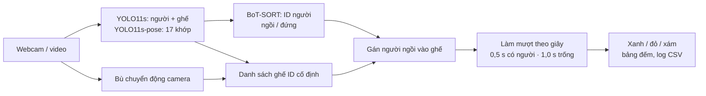

# LibSeat · Team Triangle

**Đếm chỗ trống thư viện VinUni bằng camera.** Vin Perception Hackathon · Track 4 (Computer Vision & Robotics).

Camera nhìn vào khu ghế. LibSeat tô **xanh** ghế trống, **đỏ** ghế có người, **xám** ghế chưa đủ bằng chứng, và đếm số chỗ trống theo thời gian thực để sinh viên xem trước khi đi tìm chỗ.

- **Video đã xử lý (có output của mô hình):** [Google Drive](https://drive.google.com/drive/folders/1d__Y2MqwEUp6zbe5VIRAbpQYwnfEw9Wo)
- **Báo cáo đầy đủ** (trụ cột, số đo, ca lỗi, impact, kịch bản demo): [BAO_CAO.md](BAO_CAO.md)
- **Hướng dẫn chạy cho từng vai:** [RUN_GUIDE.md](RUN_GUIDE.md) · **Chạy trên GPU Kaggle:** [kaggle/README.md](kaggle/README.md)

## Thành viên

| Họ tên | MSSV | Vai trò |
|---|---|---|
| Lê Châu Trần Phát | 2A202602545 | **A**: Pipeline và model (webcam, YOLO, tracking, giao diện) |
| Phan Trọng Hoàn | 2A202602954 | **B**: Hình học và bất định (homography, gán người vào ghế, làm mượt) |
| Nguyễn Đăng Thực | 2A202603014 | **C**: Dữ liệu, đo, trình bày (dataset, đánh giá, ca lỗi, GPU Kaggle, video) |

## Cách hoạt động



| Trụ cột Track 4 | Trong LibSeat |
|---|---|
| Học | YOLO11s pretrained COCO, cấu hình 960 px / conf 0,10 chọn trên nửa CALIB của dataset có nhãn |
| Hình học | Homography 4 mốc sàn (điểm chân → mét); bù chuyển động camera để ghế không lệch |
| Bất định | Ngưỡng tin cậy, xác nhận 3 khung, trạng thái "chưa rõ" thay vì đoán "trống" |
| Thời gian | Làm mượt tính bằng giây, timestamp từng khung, đo ms/khung và độ trễ |

## Kết quả chính

| Số đo | Kết quả |
|---|---|
| Balanced accuracy trạng thái ghế, camera cố định (seatanalysis, 408 ghế TEST) | **81,2%** (độ chính xác 84,6%) |
| Balanced accuracy, ảnh điện thoại thư viện (Beyond, 1.733 ghế TEST) | **69,8%** |
| Cải thiện nhờ chọn cấu hình bộ phát hiện (seatanalysis) | 62,2% → 81,2% |
| Tốc độ pipeline đầy đủ trên GPU T4 | 34–48 ms/khung (≤ 1080p) |
| Nhấp nháy trạng thái, thô → sau làm mượt (3 video test) | 12 → 4, 18 → 4, 16 → 4 |
| Lớp học CCTV: bản cũ → bản cuối | "12 trống / 0 có người" (sai) → **14 trống / 14 có người** |

**Ca lỗi chính:** người đứng sát ghế trống bị tính là "có người", vì hộp 2D không biết tư thế. Bản cuối sửa bằng pose (người đứng không chiếm ghế). Giới hạn và các ca lỗi khác: [BAO_CAO.md, mục 6–7](BAO_CAO.md#6-ca-lỗi).

## Chạy nhanh

```bash
python -m venv .venv && source .venv/bin/activate       # Windows: .venv\Scripts\Activate.ps1
pip install -r requirements.txt -r requirements-b.txt

python -m unittest discover -s tests -v                 # 6 unit test của vai B
python src/app.py --source 0                            # demo webcam trên CPU (s: chốt ghế, r: reset, q: thoát)
python src/app.py --source demo_backup.mp4              # chạy với video dự phòng
```

Demo bằng GPU (Kaggle T4, mở webcam trên trình duyệt qua ngrok): cần file `.env` với `KAGGLE_API_TOKEN`, `NGROK_AUTHTOKEN`, `NGROK_DOMAIN`, rồi chạy `python kaggle/push_kaggle.py`. Chi tiết: [kaggle/README.md](kaggle/README.md).

## Cấu trúc repo

```
.
├── BAO_CAO.md                 # báo cáo capstone
├── RUN_GUIDE.md               # hướng dẫn chạy cho vai A, B, C
├── ke_hoach_dem_cho_trong_thu_vien.md   # kế hoạch build 2 giờ
├── src/                       # A: app.py, detect.py · B: geometry.py, smoothing.py, occupancy.py, calibrate.py
├── tests/test_role_b.py       # unit test của vai B
├── docs/                      # B: hướng dẫn hiệu chuẩn và merge
├── libseat/                   # C: script đánh giá, kết quả đo, ca lỗi (libseat/results/metrics.md)
├── kaggle/                    # bản tích hợp cuối chạy trên GPU Kaggle + ngrok
├── data/                      # ảnh mẫu, nhãn TEST nhỏ, demo_backup.mp4
└── index.html                 # trang đề bài hackathon (mở trực tiếp bằng trình duyệt)
```

Video test (`video_test/`) và kết quả xử lý (`kaggle/output/`) **không đưa lên GitHub**: xem trên Google Drive ở trên. File `.env` chứa token, đã nằm trong `.gitignore`.

## Dữ liệu

Dataset đo độ chính xác: Beyond và seatanalysis trên Roboflow Universe (CC BY 4.0), chỉ dùng để đo, không train. Clip minh họa: Pexels #9883925, #8499766. Demo trực tiếp do thành viên tự đóng vai. Hệ thống chỉ đếm và định vị ghế, không nhận diện danh tính, không lưu khuôn mặt.
